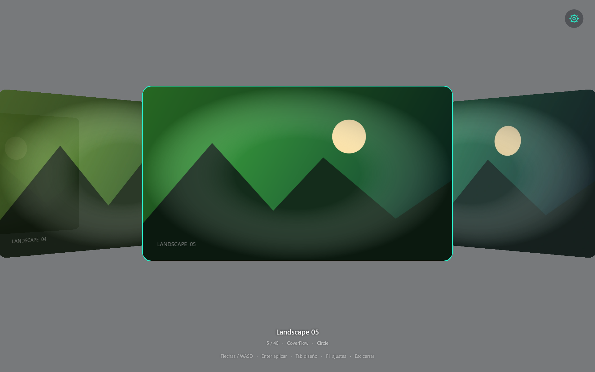
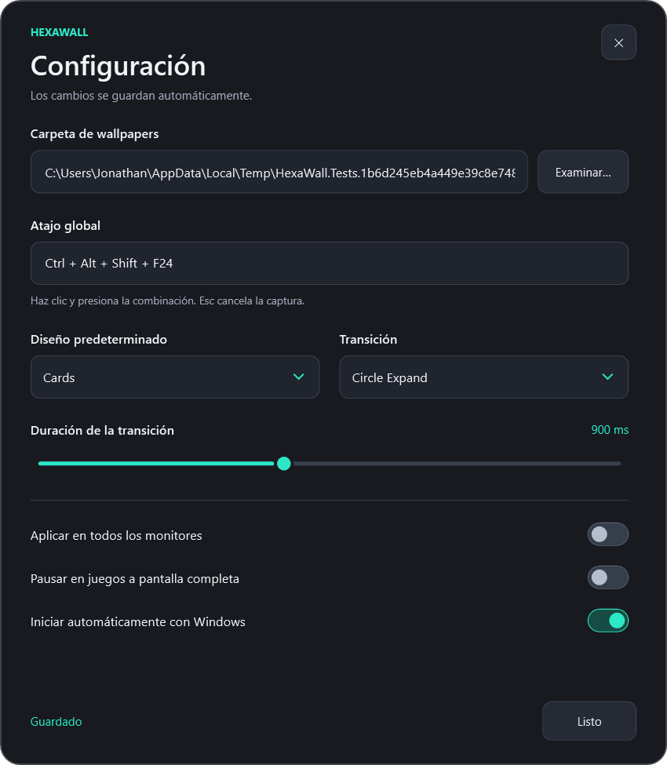

<p align="center"></p>

# HEXAWALL 1.1


Selector de wallpapers con fondo transparente, panal, carrusel 3D y tarjetas. Bandeja nativa, configuración gráfica y transiciones detrás de los iconos del escritorio.

## Probar la aplicación

1. Cierra la versión anterior desde su bandeja → **Salir**.
2. Extrae el ZIP portable 1.1 y abre `HexaWall.exe`.
3. Clic derecho en el hexágono cian de la bandeja → **Configuración…** → **Examinar…**.
4. Selecciona la carpeta de wallpapers. Los cambios se guardan automáticamente.
5. **Alt + W** abre el selector en el monitor donde está el cursor. Si elegiste otro atajo, se muestra en Configuración y en el tooltip de la bandeja.

Dentro del selector: flechas/WASD, Enter o clic para aplicar, Esc para cerrar, Tab para cambiar diseño, 1/2/3 para cambiar transición. **F1** o el engranaje abre Configuración.

Los originales se leen del primer nivel de la carpeta, sin subcarpetas: JPG, JPEG, PNG, WebP y BMP. Windows usa Fill para la imagen elegida. Las imágenes WebP se convierten a JPEG antes de asignarlas al escritorio.

## Los cinco cambios de esta versión

| Área | Implementación |
|---|---|
| Overlay | Ventana WPF `AllowsTransparency=True`, sin bordes, ajustada a `Screen.Bounds` físicos del monitor activo. Fondo ARGB `140,10,12,16`, HUD y engranaje flotantes. |
| Nitidez | PerMonitorV2; caché WebP **960 × 540**, calidad 94; selección activa desde el original con **1280 × 720 mínimo**, ajustada a DPI hasta 3840 × 2160; filtros High/HighQuality. |
| Fluidez | `CompositionTarget.Rendering`, reloj Stopwatch y convergencia exponencial por deltaTime. Posición, escala y opacidad no dependen de un temporizador de 15 ms. Se desuscribe al estabilizarse u ocultarse. |
| Bandeja | ICO de ocho tamaños generado en memoria desde geometría vectorial; hexágono `#2CE8C6`. Menú oscuro, hover y borde personalizados, con iconos dibujados para cada opción. |
| Configuración | Ventana oscura con carpeta, captura de atajo, diseño, transición, duración, monitores, pausa Gaming y autoinicio HKCU. Guardado inmediato con validación y rollback. |

El fondo tiene transparencia real hacia lo que se muestra detrás de la ventana. No se utiliza una captura estática del escritorio, ni una clave de color, ni opacidad global que desvanezca también las imágenes. Se eligió el oscurecimiento transparente solicitado; no se requiere acrílico.

Las siguientes capturas tienen alfa y usan paisajes sintéticos de prueba; el visor puede mostrarlas sobre negro:





## Configuración gráfica

- **Carpeta:** Examinar abre el selector nativo. Cambiar la carpeta sustituye el watcher y la caché activa sin reiniciar.
- **Atajo:** haz clic en el campo y pulsa una combinación con Ctrl, Alt, Shift o Win. Esc cancela. El registro se suspende durante la captura. Si la nueva combinación está ocupada, se conserva/restaura la anterior. Si el atajo inicial ya está ocupado al arrancar, la bandeja sigue disponible para corregirlo.
- **Diseño:** Honeycomb, CoverFlow o Cards. CoverFlow usa una cámara de perspectiva y planos 3D con UV correctas.
- **Transición:** Hexagon Wipe, Circle Expand o Fade. Duración de 100 a 2000 ms.
- **Monitores:** todos, o el monitor donde se confirma la selección con el cursor. El modo de ajuste Fill de Windows es global.
- **Gaming:** permite activar o desactivar la pausa de animaciones y la liberación de imágenes en pantalla completa. Las ventanas del propio proceso se excluyen de esta detección.
- **Autoinicio:** escribe/elimina solo `HexaWall` en `HKCU\Software\Microsoft\Windows\CurrentVersion\Run`, con la ruta del ejecutable entre comillas. No requiere administrador. Si mueves el portable, desactiva y vuelve a activar esta opción desde su ubicación nueva.

Los datos están en `%LOCALAPPDATA%\HexaWall`; `HEXAWALL_DATA_HOME` permite una ubicación aislada para pruebas. La carpeta `thumbnails-v2-960x540` invalida de forma natural las miniaturas antiguas de 400 px. Las miniaturas v1 no se reutilizan ni se borran automáticamente.

## Compilar y probar

Requisitos: Windows 11 x64 y SDK .NET **8.0.426**. Inno Setup 6.4.3 o posterior de la serie 6 para generar el instalador.

```powershell
dotnet restore tests/HexaWall.Tests/HexaWall.Tests.csproj --locked-mode --configfile NuGet.Config
dotnet run --project tests/HexaWall.Tests/HexaWall.Tests.csproj -c Release --no-restore
dotnet restore src/HexaWall/HexaWall.csproj -r win-x64 -p:SelfContained=true --locked-mode --configfile NuGet.Config
dotnet publish src/HexaWall/HexaWall.csproj -c Release -r win-x64 --self-contained true --no-restore -p:Version=1.1.0 -o artifacts/publish
& 'C:\Program Files (x86)\Inno Setup 6\ISCC.exe' '/DAppVersion=1.1.0' installer/HexaWall.iss
```

Prueba visual opcional, con imágenes sintéticas y registro de autoinicio simulado:

```powershell
dotnet run --project tests/HexaWall.Tests/HexaWall.Tests.csproj -c Release -- --ui "$PWD/artifacts/preview"
```

Abre y cierra ventanas de prueba; no aplica wallpapers ni modifica la entrada real de inicio de Windows. Verifica alfa, bounds, reapertura y guardado desde los controles.

El ICO incrustado del ejecutable se puede regenerar con la misma función vectorial que usa la bandeja:

```powershell
dotnet run --project tests/HexaWall.Tests/HexaWall.Tests.csproj -c Release -- --write-icon "$PWD/assets/hexawall.ico"
```

## Estructura

```text
src/HexaWall/
  Program.cs                         Bandeja y ciclo de vida WinForms/WPF
  OverlayWindow.cs                   Fullscreen transparente, layouts y deltaTime
  SettingsWindow.xaml[.cs]           GUI oscura y captura de atajos
  ThumbnailCache.cs                 Watcher, WebP 960×540 y LRU
  SelectedPreview.cs                 Decodificador prioritario de la selección
  ImageLoader.cs                     Skia High, EXIF y BitmapSources congelados
  IconFactory.cs                     ICO multirresolución y pictogramas
  DarkMenuRenderer.cs                Tema del menú nativo
  Settings.cs, StartupRegistration.cs Persistencia y transacciones de configuración
  HotKeyWindow.cs, GamingMonitor.cs   Atajos y detección por eventos
  Native.cs, WorkerW.cs               P/Invoke e integración con Explorer
  DesktopWallpaper.cs               COM multimonitor
  GpuView.cs, Transition*.cs          Transiciones Skia/WGL del escritorio
  WallpaperFile.cs                   Conversión persistente de WebP
assets/                              Iconos, capturas y licencias
installer/HexaWall.iss
.github/workflows/release.yml
tests/HexaWall.Tests/
docs/ARCHITECTURE.md, VALIDATION.md, CHANGES-1.1.md
```

`OverlayForm.cs` se eliminó y fue reemplazado por `OverlayWindow.cs`. Si integras archivos a mano sobre v1.0, elimina ese archivo antiguo. El ZIP fuente contiene el árbol completo correcto.

## Rendimiento y límites

La UI no impone un tope de 60 FPS. Su reloj es el compositor de WPF/Windows; la frecuencia efectiva depende del monitor, la GPU, el driver, RDP y la carga. Se probó que la interpolación produce el mismo resultado temporal a 60/144/165 Hz; **eso no es una medición física de 165 FPS**.

Las capturas y controles se validaron con WPF tier 2. El consumo de RAM aumenta con miniaturas más grandes y WPF: la caché de miniaturas es de 64 MiB por defecto y las imágenes visibles pueden retener referencias adicionales. No se afirma el objetivo antiguo de <35 MB ni apertura garantizada <16 ms. Las imágenes originales pequeñas no ganan detalle real por reescalarlas.

El motor WorkerW se conserva: utiliza una jerarquía no documentada de Explorer, valida el host y aplica un fondo estático si no está disponible. Su compatibilidad debe comprobarse en las versiones y topologías de monitores de destino. La detección de fullscreen puede incluir vídeos o presentaciones; el toggle permite desactivarla. HDR, slideshow, vídeo y fondos distintos por escritorio virtual no están implementados.

Consulta [validación](docs/VALIDATION.md) y [arquitectura](docs/ARCHITECTURE.md).

## Publicar

El workflow compila, prueba, genera el Single-File y el instalador, empaqueta licencias/checksums y publica una Release para un tag estable:

```powershell
git tag v1.1.0
git push origin v1.1.0
```

`workflow_dispatch` genera artefactos sin publicar una Release. Los ejecutables se distribuyen sin firma Authenticode. La licencia del proyecto es [MIT](LICENSE); las de sus dependencias se incluyen en los paquetes.
