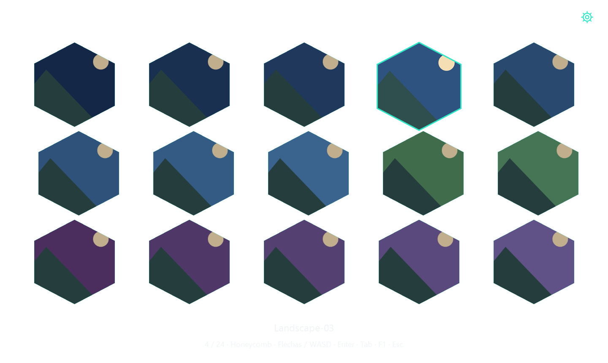
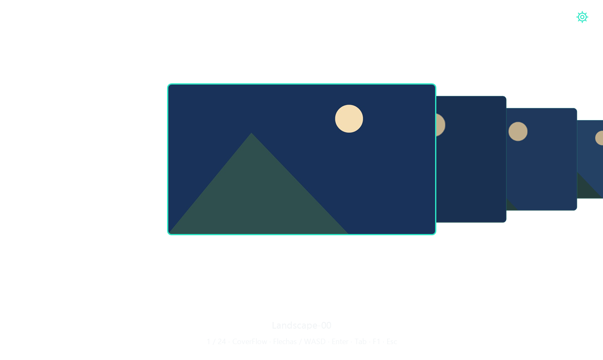
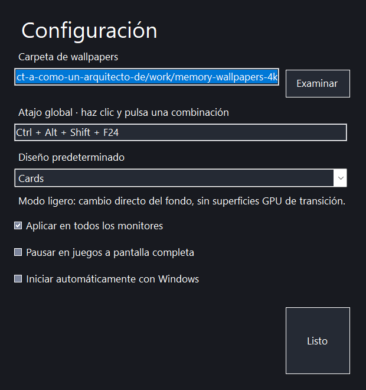

<div align="center">


# HEXAWALL 1.2 · Lite


**Fondos de pantalla desde una bandeja ligera. Sin WPF, Skia ni bucle GPU residente.**

[Descargar instalador o portable](https://github.com/xJhony911/HEXAWALL/releases/latest)
</div>

## Elige tu edición

- [1.2 Lite](https://github.com/xJhony911/HEXAWALL/releases/tag/v1.2.0): menor consumo, carrusel 2D y cambio directo de fondo.
- [1.1 con efectos](https://github.com/xJhony911/HEXAWALL/releases/tag/v1.1.0): interfaz WPF, CoverFlow 3D y transiciones de escritorio; mayor consumo de memoria.

Ambas ediciones siguen disponibles. Cierra una antes de ejecutar la otra; comparten configuración y atajo.

**Avisos de Windows:** los binarios de GitHub aún no tienen firma Authenticode. SmartScreen puede mostrar advertencias y Smart App Control puede bloquearlos. Publicar en GitHub no elimina estas comprobaciones. No se desactivan protecciones ni se garantiza un arranque sin avisos. La firma de confianza queda pendiente.

## Uso

Cierra la versión anterior desde la bandeja antes de instalar o abrir esta versión. Ejecuta `HexaWall.exe`, pulsa **Alt + W** y elige una imagen. Tu atajo personalizado y carpeta existente se conservan. **F1**, el engranaje o el menú de la bandeja abren Configuración. **Examinar…** permite elegir la carpeta; los cambios se guardan automáticamente.

Flechas / WASD navegan, Enter o clic aplican, Tab cambia entre Honeycomb, CoverFlow y Cards; Esc cierra. El atajo también cierra un selector abierto. Se examina el primer nivel de la carpeta, hasta 20.000 archivos.

## Cambio de prioridades en 1.2

Esta versión prioriza el objetivo de **menos de 50 MB en la memoria privada residente mostrada habitualmente en la pestaña Procesos del Administrador de tareas**, también durante el selector. Se reemplazó la interfaz WPF por WinForms/Win32, una superficie alfa GDI acotada y Windows Imaging Component (WIC).

- Fondo real del escritorio con oscurecimiento nativo del monitor completo; los elementos flotan sin caja gris.
- Superficie de contenido limitada a 1440×860 píxeles físicos, incluso en monitores 4K. El resto del monitor sigue oscurecido.
- Hasta 18 miniaturas visibles; residentes de 320×180, imagen seleccionada hasta 960×540. Caché JPEG en disco de hasta 960 píxeles, limitada a 128 MiB.
- Un decodificador secuencial; solicitudes obsoletas se descartan y todas las imágenes/DIB se destruyen al cerrar.
- Sin compresión interna del Single-File: ocupa más espacio en disco, pero evita descomprimir ensamblados en memoria privada. El ZIP y el instalador sí se comprimen.
- Bandeja y configuración oscuras, icono cian, atajo nativo, watcher de carpeta y autoinicio opcional en HKCU.

**Efectos simplificados:** CoverFlow es un carrusel 2D con escala y atenuación, sin perspectiva 3D real. El cambio de wallpaper es directo: se desactivaron las transiciones WorkerW, las sombras GPU y el objetivo de 144/165 FPS para respetar la prioridad de memoria. Suavizado temporal del carrusel durante el desplazamiento; ningún temporizador de animación queda activo en reposo.

La configuración conserva carpeta, atajo, diseño, todos los monitores, pausa en juegos y autoinicio. Los campos antiguos de transición siguen en JSON para compatibilidad, pero Lite no los ejecuta.

## Memoria: cómo comprobarla

Consulta [el informe de memoria](docs/MEMORY-1.2.md). Se reportan por separado memoria privada residente, compromiso privado y working set total. El total incluye DLL compartidas y **no** es la misma métrica que la captura de Procesos. No se fuerza `EmptyWorkingSet`, no se limita artificialmente el working set y no se ocultan procesos auxiliares: Lite funciona en **un único proceso**.

Las cifras son mediciones, no un límite impuesto por Windows. Otro monitor, codecs de terceros, cantidad de archivos o nuevas versiones del runtime pueden cambiar el consumo. Imágenes de más de 32 megapíxeles se rechazan antes de copiar píxeles; una imagen no compatible conserva su casilla sin bloquear la aplicación.

PNG/JPEG/BMP se aplican a su resolución original. WebP requiere un codec WIC disponible en Windows y se convierte a JPEG de hasta 1920×1080 para el fondo, evitando grandes buffers. El original no se modifica. La conversión se guarda en `%LOCALAPPDATA%\HexaWall\wallpapers-lite`.

## Capturas

Son capturas con alfa de imágenes sintéticas; el visor puede mostrarlas sobre negro.





## Compilar

Windows 11 x64 y SDK .NET 8.0.426. Desde la raíz:

```powershell
dotnet restore tests/HexaWall.Lite.Tests/HexaWall.Lite.Tests.csproj --locked-mode --configfile NuGet.Config
dotnet run --project tests/HexaWall.Lite.Tests -c Release --no-restore
dotnet restore src/HexaWall.Lite/HexaWall.Lite.csproj -r win-x64 -p:SelfContained=true --locked-mode --configfile NuGet.Config
dotnet publish src/HexaWall.Lite/HexaWall.Lite.csproj -c Release -r win-x64 --self-contained true --no-restore -o artifacts/publish
& 'C:\Program Files (x86)\Inno Setup 6\ISCC.exe' '/DAppVersion=1.2.0' installer/HexaWall.iss
```

El workflow publica instalador, portable, ejecutable y SHA256SUMS al crear un tag `vMAJOR.MINOR.PATCH`. Los ejecutables no tienen firma Authenticode.

## Estructura

- `src/HexaWall.Lite/`: aplicación distribuida desde 1.2, sin dependencias NuGet externas.
- `src/HexaWall/`: implementación WPF/Skia anterior y clases compartidas de Win32, iconos, configuración y wallpaper COM. Su proyecto se conserva como referencia; no forma parte del ejecutable Lite.
- `tests/HexaWall.Lite.Tests/`: pruebas de WIC, alfa, caché, atajos y configuración.
- `installer/`, `.github/workflows/`, `assets/`, `docs/`: distribución, recursos e informes.

Licencia [MIT](LICENSE). Las bibliotecas de .NET incluidas conservan sus respectivas licencias.
